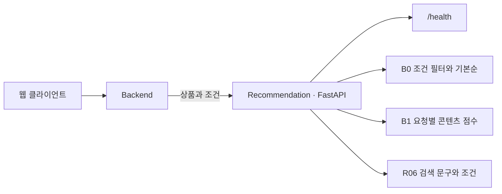

<div align="center">
  
  <h1>주점부리 · Recommendation</h1>
  <p><strong>취향에 맞는 한 잔을 발견하고 기록하는 주류 큐레이션</strong></p>
  <a href="https://github.com/Pubburi/Recommendation/actions/workflows/ci.yml"></a>
    
</div>

<br />

## 📄 목차

- [프로젝트 개요](#overview)
- [현재 기능과 범위](#features)
- [기술 스택](#technology)
- [시스템 구조](#architecture)
- [문제 해결](#problem-solving)
- [로컬 실행](#development)
- [검증과 협업](#verification)
- [개발 계획](#roadmap)

<br />

<a id="overview"></a>

## ✍ 프로젝트 개요

Backend에서 받은 상품과 조건으로 주점부리의 추천 후보를 고릅니다. 검수한 시연 카탈로그를 웹에 연결해 추천 결과와 점수에 기여한 상품 특성을 보여 줍니다.

<a id="features"></a>

## 🥃 현재 기능과 범위

| 영역 | 현재 제공 기능 |
|---|---|
| B0 기본 추천 | 주종·가격·도수 등 필수 조건과 제외 목록을 적용한 뒤 일정한 순서로 반환합니다. 조건을 확인할 값이 없으면 해당 후보를 제외합니다. |
| B1 콘텐츠 추천 | 요청의 상품으로 TF-IDF와 수치 변환을 맞추고, 취향이나 기준 상품과의 유사도 및 점수에 기여한 특성을 반환합니다. |
| 상품 탐색 | 취향 탐색, 유사 상품, 장바구니·시연 주문의 기준 상품, 좋아요·관심 없음에 각각 맞는 후보를 고릅니다. |
| 검색 문구 | 선택한 취향에 맞춰 검색 문구와 조건을 제안합니다. 사용자가 적용한 조건으로 검색합니다. |
| 원천 데이터 검수 | Wikidata 응답의 ID와 버전을 확인해 보관합니다. 오프라인에서 원문을 재생하고 단위, 포장, 상품군, 업무 상품 매핑을 검수합니다. |
| 오프라인 비교 | 미리 확정한 상품 사실과 조건으로 B0와 B1을 비교합니다. 표현 학습 실험은 훈련에 쓰지 않은 제조사와 상품군을 따로 평가합니다. |

DB, 모델 파일, 외부 AI 키 없이 실행할 수 있습니다.

<a id="technology"></a>

## ⚙️ 기술 스택

| 분류 | 기술 스택 |
|---|---|
| 언어 | Python |
| API | FastAPI |
| 서버 | Uvicorn |
| 모델·수치 연산 | scikit-learn · NumPy |
| 의존성·패키징 | uv · Hatchling |
| 테스트 | pytest · HTTPX |
| 코드 품질 | Ruff |
| CI | GitHub Actions |

<a id="architecture"></a>

## 🏛️ 시스템 구조



Backend가 상품과 사용자 상태를 관리하고, Recommendation은 요청마다 후보를 계산합니다.

<a id="problem-solving"></a>

## 🧩 문제 해결

### 1. HTTP200 안의 원천 오류를 격리한 카탈로그 수집

#### 문제

카탈로그 원천을 조사하다가 HTTP 200 응답의 본문에서 `maxlag` 오류를 발견했다. 오류를 빈 검색 결과로 처리하면 나중에 해당 원천을 재검토할 이유가 사라지고, 카탈로그에 상품이 없다는 잘못된 결론을 낼 수 있었다.

#### 원인

조사용 코드가 `payload.get("search", [])`로 결과를 읽어서, `search` 필드 없이 오류만 담긴 응답도 빈 배열이 됐다. HTTP 상태와 JSON 형식만 검사하면 응답에서 요청 ID가 빠졌거나 다른 버전이 온 경우도 놓칠 수 있었다.

#### 해결

고정 주소로 소량을 요청하고 `maxlag=5`를 적용했다. 원문을 저장하기 전에 본문의 오류와 경고, 응답 ID, 버전, 단위를 검사한다. 결과는 새 디렉터리에 쓰고 성공 여부를 기록한 파일을 원자적으로 발행한다. 응답 해시와 버전, 수집 또는 재생 여부도 함께 기록해 이전 수집본을 다시 확인할 수 있게 했다.

#### 결과

실제로 관측한 단건 응답은 `api_maxlag`와 `accepted=false`를 남기고 실패로 종료했다. 승인된 신규 원천 항목은 0건이었다. 기존 CC0 항목 4건은 원문 해시를 그대로 유지한 채 오프라인에서 재생했다.

#### 대체안/회고

즉시 재요청하거나 `maxlag` 한도를 높이면 원천에 다시 부하를 준다. 수집을 보류하고 기존 수집본으로 작업을 계속할 수 있게 했다. 정상 응답이 돌아와도 상품군 검수와 판매 상품 매핑을 거쳐 학습 입력에 포함한다. 헬스 체크와 B0는 수집 과정과 독립적으로 기동한다.

#### 코드

```python
    if "error" in payload:
        error = payload["error"]
        code = error.get("code") if isinstance(error, dict) else None
        raise AuditError(
            API_ERRORS.get(code, "unrecognized_api_error")
            if isinstance(code, str)
            else "unrecognized_api_error"
        )
```

### 2. JSON 해석부터 필수 조건과 상품 ID를 보존한 추천

#### 문제

기존 서버에 도수 상한을 `5`와 `50`으로 중복 선언한 테스트 요청을 보내자 B0와 B1 모두 HTTP 200으로 응답했고, 도수 40% 상품이 포함됐다. 상품 객체에 ID를 두 번 넣었을 때도 두 번째 ID로 조회됐다.

#### 원인

JSON 디코더가 같은 필드의 마지막 값만 남겨 Pydantic에 전달했다. 도수 상한 `50` 자체는 타입과 범위 검사를 통과한다. 필터가 실행될 때는 앞에 있던 상한 `5`를 읽을 수 없었다.

#### 해결

본문을 최대 512 KiB, 10초까지 받은 뒤 JSON 객체마다 디코딩된 필드 이름을 비교한다. 전체 파싱에 성공하고 한 객체 안에서 이름이 겹치면 스키마 검사와 모델 계산 전에 HTTP 422를 반환한다. 값이 같거나 이스케이프 표기가 달라도 중복이다. 서로 다른 상품 객체에서 같은 필드 이름을 쓰는 요청은 통과한다.

#### 결과

도수 상한과 상품 ID를 중복 선언한 요청은 모두 HTTP 422로 끝났다. 상한 `5`를 한 번만 선언한 요청에서는 도수 40% 상품을 제외했다.

#### 대체안/회고

첫 값이나 마지막 값을 고르는 방식은 충돌을 숨긴다. 중복을 응답으로 알리기 위해 크기 제한을 둔 본문을 한 번 더 파싱하는 CPU·메모리 비용을 받아들였다. 깨진 문법이나 인코딩, 지나치게 깊은 JSON은 FastAPI의 기존 오류 처리로 보낸다. 10초 제한은 본문을 받는 구간에 적용된다.

#### 코드

```python
    try:
        # Object hooks see decoded names, so escaped equivalent keys cannot evade this check.
        # Discard this bounded preflight tree; FastAPI still owns schema/numeric validation.
        json.loads(body, object_pairs_hook=unique_object)
    except (ValueError, UnicodeError, RecursionError):
        # Malformed encodings/syntax/depth keep the framework's existing client-error behavior.
        # A duplicate found before a later parse error must not mask that error.
        return False
    return duplicate
```

### 3. 원천 수량의 의미를 지켜 잘못된 학습 관측 차단

#### 문제

다른 호스트의 단위 URI를 쓰거나 수량 메타데이터를 모순되게 만든 테스트 원문이 도수 5%로 변환됐다. 오프라인 수집 기록과 검수 파일의 해시를 맞추자 상품군 실험 CLI가 이 수치까지 MinMax 학습에 사용했다.

#### 원인

`scalar_quantity`는 URI의 마지막 `/` 뒤 QID만 비교했다. 호스트와 경로가 달라도 QID가 같으면 변환했다. 또한 claims의 속성, snak의 속성 및 데이터 형식, datavalue의 타입이 서로 달라도 값의 모양과 범위만 맞으면 통과했다. 파일 해시는 원문이 일치하는지 확인하는 데 쓰였으므로 이 값의 의미까지 검사해야 했다.

#### 해결

지원하는 Wikidata HTTP·HTTPS entity URI를 전체 문자열로 비교한다. 속성이나 타입이 모순되면 해당 수량만 `null`과 검토 사유로 남긴다. 생략이 허용된 메타데이터와 관측값 0은 그대로 읽는다. 단일 수량, 포장, 문맥 검사가 같은 단위 표를 쓰고, 학습 전에 원천을 대조해 미확인 수량을 숫자로 적은 명세를 거절한다.

#### 결과

가상 상품군 3개를 학습 2개, 변환 1개로 나눈 재현에서 잘못된 수치 승인과 학습 보고서 승인은 각각 **10/10 → 0/10**으로 줄었다. 수정한 명세를 적용하자 도수 15% 한 건만 관측돼 해당 열은 상수로 처리했다. 실제 원천 상품군 11개를 학습 5개, 변환 6개로 나눈 기존 실험에서는 보고서와 fingerprint, 원천 해시가 같았다. 100%p 감소는 의도적으로 손상한 10건의 오류율을 비교한 값이다.

#### 대체안/회고

상품 전체를 거절하면 확인된 이름과 주종도 사용할 수 없다. 문제가 난 수량만 미확인으로 남겨 나머지 정보를 보존했다. 새 원천이나 단위를 받을 때는 URI 변환표를 확장하고 이용 권리와 상품 식별 근거를 별도로 확인해야 한다.

#### 코드

```python
        if (
            ("property" in snak and snak["property"] != prop)
            or ("datatype" in snak and snak["datatype"] != "quantity")
            or ("type" in data and data["type"] != "quantity")
        ):
            issues.add("quantity_statement_requires_review")
            continue
        unit = value.get("unit")
        if not isinstance(unit, str) or unit not in unit_factors:
            issues.add("unsupported_unit")
            continue
```

### 4. health 뒤 첫 추천이 제한 시간을 넘던 초기화 경계

#### 문제

로컬에서 웹, Backend, 추천 서버를 함께 띄웠을 때 헬스 체크는 통과했다. 직후의 첫 B1 추천은 Backend의 3초 제한을 넘겨 `UNAVAILABLE`을 반환했다. 기본 목록은 별도로 선택할 수 있었다. 같은 프로세스에 두 번째 추천을 보내면 몇 ms 만에 응답했다.

#### 원인

B1 수치 라이브러리를 첫 요청에서 처음 불러왔다. 같은 상품 6개와 런타임 의존성만 설치한 환경 3회에서 첫 요청은 22.40–22.82초, 이어진 요청은 3.38–4.45ms였다. 단계별 진단에서 scikit-learn 의존성을 불러오는 데 약 21초가 걸렸다. 바이트코드 생성과 운영체제의 초기 로드가 각각 차지한 시간은 확인하지 못했다.

#### 해결

ASGI lifespan에서 수치 라이브러리를 먼저 불러오도록 했다. 모델 학습은 상품을 받은 뒤 요청 안에서 실행한다. 라이브러리를 읽다가 Python 예외가 나면 예외 종류를 기록하고 헬스 체크와 B0를 기동한다. Backend는 기존 3초 제한을 계속 적용한다.

#### 결과

같은 조건에서 헬스 체크 이후 첫 추천이 3초를 넘긴 횟수는 **3/3 → 0/3**이었다. 순위, 점수, fingerprint, 추천 이유는 같았다. 헬스 체크가 준비되기까지 약 23초가 걸렸고, 프로세스 시작부터 첫 추천까지도 약 23초였다. 비교에 앞서 관측 한도 20초를 넘긴 실행 1회는 실패로 따로 기록했다.

#### 대체안/회고

요청 제한을 늘리면 첫 사용자가 라이브러리 로드를 기다린다. 프로젝트 wheel만 미리 바이트코드로 만들어도 첫 응답은 느렸다. 전체 의존성을 미리 컴파일하는 방법은 실험하지 않았다. 초기화 대기를 서버 기동으로 옮겼고, B1 의존성 예외가 발생하면 Backend가 기존 대체 응답을 사용한다. Python 예외 처리는 프로세스 강제 종료나 끝나지 않는 import까지 복구할 수 없다.

#### 코드

```python
@asynccontextmanager
async def lifespan(_app: FastAPI):
    # Pay dependency initialization before accepting B1 traffic; never fit sample/user data.
    # Numerical dependency failures must leave the independent health/B0 paths available.
    try:
        import_module("pubburi_recommendation.content_model")
    except Exception as error:
        logging.getLogger(__name__).warning(
            "B1 dependency preparation failed (%s); health/B0 remain available",
            type(error).__name__,
        )
    yield
```

<a id="development"></a>

## 🚀 로컬 실행

Python 3.12와 uv 0.13.6으로 레포 루트에서 실행합니다.

```bash
uv sync --locked
./scripts/dev.sh
```

기본 포트는 8000입니다. `PUBBURI_RECOMMENDATION_PORT`로 바꿀 수 있습니다. [헬스 체크](http://localhost:8000/health) · [API 문서](http://localhost:8000/docs) · [전체 서비스 로컬 실행](https://github.com/Pubburi/Backend/blob/main/docs/LOCAL-DEVELOPMENT.md)

- 원천을 확인하고 카탈로그를 만듭니다. [원천 감사](docs/CATALOG-AUDIT.md) · [카탈로그](docs/SOURCE-CATALOG.md) · [업무 매핑](docs/BUSINESS-EXPORT.md)
- 모델을 실행하고 시나리오 결과를 검사합니다. [콘텐츠 모델](docs/CONTENT-MODEL.md) · [평가 절차](docs/EVALUATION.md)

<a id="verification"></a>

## ✅ 검증과 협업

```bash
./scripts/check.sh
```

검사 스크립트는 테스트를 실행하고, 새로 만든 배포 파일을 격리 환경에 설치해 HTTP 응답을 확인합니다. [테스트·CI 안내](docs/TESTING.md)

최신 main을 반영한 PR에서 `recommendation-ci`와 필요한 리뷰를 마친 뒤 squash merge합니다. [협업 규칙](CONTRIBUTING.md) · [추천 개발 기준](AGENTS.md)

<a id="roadmap"></a>

## 🗺️ 개발 계획

검수 카탈로그를 늘리고 새 상품군에서 B1과 모델 후보를 비교합니다. 전체 MVP 기한은 2026년 12월 31일, 최종 인계는 2027년 2월 5일입니다. [추천 데이터·모델 계획](docs/DATA-AND-MODEL-PLAN.md)
