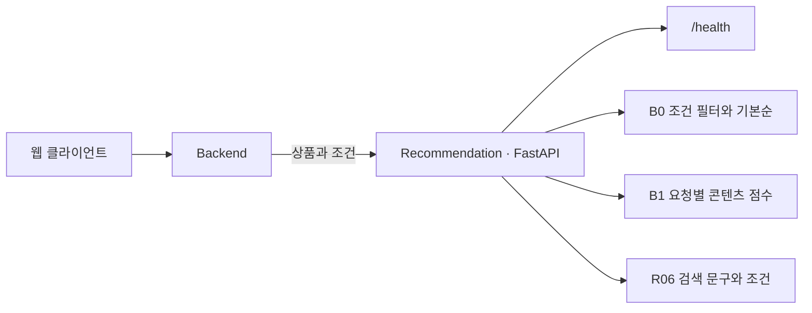

<div align="center">
  
  <h1>주점부리 · Recommendation</h1>
  <p><strong>취향에 맞는 한 잔을 발견하고 기록하는 주류 큐레이션</strong></p>
  <a href="https://github.com/Pubburi/Recommendation/actions/workflows/ci.yml"></a>
    
</div>

<br />

## 📄 목차

- [프로젝트 개요](#overview)
- [현재 기능과 범위](#features)
- [기술 스택](#technology)
- [시스템 구조](#architecture)
- [문제 해결](#problem-solving)
- [로컬 실행](#development)
- [검증과 협업](#verification)
- [개발 계획](#roadmap)

<br />

<a id="overview"></a>

## ✍ 프로젝트 개요

Backend에서 받은 상품과 조건으로 주점부리의 추천 후보를 고릅니다. 검수한 시연 카탈로그를 웹에 연결해 추천 결과와 점수에 기여한 상품 특성을 보여 줍니다.

<a id="features"></a>

## 🥃 현재 기능과 범위

| 영역 | 현재 제공 기능 |
|---|---|
| B0 기본 추천 | 주종·가격·도수 등 필수 조건과 제외 목록을 적용한 뒤 일정한 순서로 반환합니다. 조건을 확인할 값이 없으면 해당 후보를 제외합니다. |
| B1 콘텐츠 추천 | 요청의 상품으로 TF-IDF와 수치 변환을 맞추고, 취향이나 기준 상품과의 유사도 및 점수에 기여한 특성을 반환합니다. |
| 상품 탐색 | 취향 탐색, 유사 상품, 장바구니·시연 주문의 기준 상품, 좋아요·관심 없음에 각각 맞는 후보를 고릅니다. |
| 검색 문구 | 선택한 취향에 맞춰 검색 문구와 조건을 제안합니다. 사용자가 적용한 조건으로 검색합니다. |
| 원천 데이터 검수 | Wikidata 응답의 ID와 버전을 확인해 보관합니다. 오프라인에서 원문을 재생하고 단위, 포장, 상품군, 업무 상품 매핑을 검수합니다. |
| 오프라인 비교 | 미리 확정한 상품 사실과 조건으로 B0와 B1을 비교합니다. 표현 학습 실험은 훈련에 쓰지 않은 제조사와 상품군을 따로 평가합니다. |

DB, 모델 파일, 외부 AI 키 없이 실행할 수 있습니다.

<a id="technology"></a>

## ⚙️ 기술 스택

| 분류 | 기술 스택 |
|---|---|
| 언어 | Python |
| API | FastAPI |
| 서버 | Uvicorn |
| 모델·수치 연산 | scikit-learn · NumPy |
| 의존성·패키징 | uv · Hatchling |
| 테스트 | pytest · HTTPX |
| 코드 품질 | Ruff |
| CI | GitHub Actions |

<a id="architecture"></a>

## 🏛️ 시스템 구조



Backend가 상품과 사용자 상태를 관리하고, Recommendation은 요청마다 후보를 계산합니다.

<a id="problem-solving"></a>

## 🧩 문제 해결

### health 뒤 첫 추천이 제한 시간을 넘던 초기화 경계

#### 문제

로컬에서 웹, Backend, 추천 서버를 함께 띄웠을 때 헬스 체크는 통과했다. 직후의 첫 B1 추천은 Backend의 3초 제한을 넘겨 `UNAVAILABLE`을 반환했다. 기본 목록은 별도로 선택할 수 있었다. 같은 프로세스에 두 번째 추천을 보내면 몇 ms 만에 응답했다.

#### 원인

B1 수치 라이브러리를 첫 요청에서 처음 불러왔다. 같은 상품 6개와 런타임 의존성만 설치한 환경 3회에서 첫 요청은 22.40–22.82초, 이어진 요청은 3.38–4.45ms였다. 단계별 진단에서 scikit-learn 의존성을 불러오는 데 약 21초가 걸렸다. 바이트코드 생성과 운영체제의 초기 로드가 각각 차지한 시간은 확인하지 못했다.

#### 해결

ASGI lifespan에서 수치 라이브러리를 먼저 불러오도록 했다. 모델 학습은 상품을 받은 뒤 요청 안에서 실행한다. 라이브러리를 읽다가 Python 예외가 나면 예외 종류를 기록하고 헬스 체크와 B0를 기동한다. Backend는 기존 3초 제한을 계속 적용한다.

#### 결과

같은 조건에서 헬스 체크 이후 첫 추천이 3초를 넘긴 횟수는 **3/3 → 0/3**이었다. 순위, 점수, fingerprint, 추천 이유는 같았다. 헬스 체크가 준비되기까지 약 23초가 걸렸고, 프로세스 시작부터 첫 추천까지도 약 23초였다. 비교에 앞서 관측 한도 20초를 넘긴 실행 1회는 실패로 따로 기록했다.

#### 대체안/회고

요청 제한을 늘리면 첫 사용자가 라이브러리 로드를 기다린다. 프로젝트 wheel만 미리 바이트코드로 만들어도 첫 응답은 느렸다. 전체 의존성을 미리 컴파일하는 방법은 실험하지 않았다. 초기화 대기를 서버 기동으로 옮겼고, B1 의존성 예외가 발생하면 Backend가 기존 대체 응답을 사용한다. Python 예외 처리는 프로세스 강제 종료나 끝나지 않는 import까지 복구할 수 없다.

#### 코드

```python
@asynccontextmanager
async def lifespan(_app: FastAPI):
    # Pay dependency initialization before accepting B1 traffic; never fit sample/user data.
    # Numerical dependency failures must leave the independent health/B0 paths available.
    try:
        import_module("pubburi_recommendation.content_model")
    except Exception as error:
        logging.getLogger(__name__).warning(
            "B1 dependency preparation failed (%s); health/B0 remain available",
            type(error).__name__,
        )
    yield
```

<a id="development"></a>

## 🚀 로컬 실행

Python 3.12와 uv 0.13.6으로 레포 루트에서 실행합니다.

```bash
uv sync --locked
./scripts/dev.sh
```

기본 포트는 8000입니다. `PUBBURI_RECOMMENDATION_PORT`로 바꿀 수 있습니다. [헬스 체크](http://localhost:8000/health) · [API 문서](http://localhost:8000/docs) · [전체 서비스 로컬 실행](https://github.com/Pubburi/Backend/blob/main/docs/LOCAL-DEVELOPMENT.md)

- 원천을 확인하고 카탈로그를 만듭니다. [원천 감사](docs/CATALOG-AUDIT.md) · [카탈로그](docs/SOURCE-CATALOG.md) · [업무 매핑](docs/BUSINESS-EXPORT.md)
- 모델을 실행하고 시나리오 결과를 검사합니다. [콘텐츠 모델](docs/CONTENT-MODEL.md) · [평가 절차](docs/EVALUATION.md)

<a id="verification"></a>

## ✅ 검증과 협업

```bash
./scripts/check.sh
```

검사 스크립트는 테스트를 실행하고, 새로 만든 배포 파일을 격리 환경에 설치해 HTTP 응답을 확인합니다. [테스트·CI 안내](docs/TESTING.md)

최신 main을 반영한 PR에서 `recommendation-ci`와 필요한 리뷰를 마친 뒤 squash merge합니다. [협업 규칙](CONTRIBUTING.md) · [추천 개발 기준](AGENTS.md)

<a id="roadmap"></a>

## 🗺️ 개발 계획

검수 카탈로그를 늘리고 새 상품군에서 B1과 모델 후보를 비교합니다. 전체 MVP 기한은 2026년 12월 31일, 최종 인계는 2027년 2월 5일입니다. [추천 데이터·모델 계획](docs/DATA-AND-MODEL-PLAN.md)
