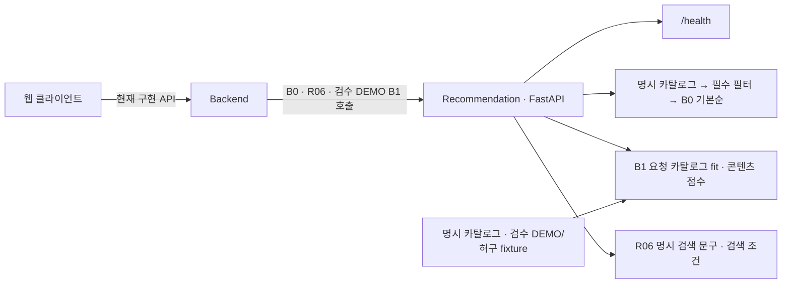

<div align="center">
  
  <h1>주점부리 · Recommendation</h1>
  <p><strong>취향에 맞는 한 잔을 발견하고 기록하는 주류 큐레이션</strong></p>
  <p>Python·FastAPI 기반 추천 서비스</p>
  <a href="https://github.com/Pubburi/Recommendation/actions/workflows/ci.yml"></a>
    
</div>

<br />

## 📄 목차

- [프로젝트 개요](#overview)
- [현재 기능과 범위](#features)
- [기술 스택](#technology)
- [시스템 구조](#architecture)
- [문제 해결](#problem-solving)
- [로컬 실행](#development)
- [검증과 협업](#verification)
- [개발 계획](#roadmap)

<br />

<a id="overview"></a>

## ✍ 프로젝트 개요

주점부리의 Python·FastAPI 서버입니다. 명시 카탈로그·필수 조건의 B0 기본 추천, 요청별 fit/rank하는 B1 콘텐츠와 R06 명시 검색 문구 HTTP, 원천 감사·표현 실험·API 문서·패키징·CI를 제공합니다. Backend의 B0·R06 호출과 검수 DEMO의 B1·웹 이유 표시를 연결했습니다. B0는 학습하지 않는 기준선이며 일반 서비스 SKU 카탈로그 채택·추천 품질 평가·최종 인수는 진행할 과제입니다.

<a id="features"></a>

## 🥃 현재 기능과 범위

| 영역 | 현재 제공 기능 |
|---|---|
| 헬스 체크 | GET /health → 상태와 서비스 이름 반환 |
| 기본 추천 | POST /v1/recommendations/baseline → 필수/제외 조건을 통과한 상품 ID 기본순과 적용 이유 |
| 제약·결측 처리 | 주종·가격·도수·입력 가용성·제외 ID, unknown을 요구 조건에 임의 통과시키지 않음 |
| 오프라인 원천 감사 | 명세·출처/revision·수량 단위·분류/생산자 관계 모순·unknown·브랜드/SKU 정체성을 구분하고 명시 검수 후 B0 시연 요청 변환 |
| 제한된 원천 수집 | 고정 Wikidata GET·ID/revision/오류 검증·기본 라벨/원천 언어 보존·불변 snapshot/영수증·offline 재생. 수집 검증과 실제 SKU/학습 준비를 구분 |
| 기존 시드·자산 감사 | SQL 실행 없이 활성 상품 literal·실제 웹 이미지 매핑·해시/중복·개별 사실/권리 미확인을 분리하고 학습 입력으로 자동 승격하지 않음 |
| 고정 시나리오 검사 | 수동 기대 사실·명세/응답 해시를 고정하고 추천 엔진과 분리해 제약·중복·결측·이유·후보 부족 확인 |
| 콘텐츠 추천 HTTP | POST /v1/recommendations/content → 요청 카탈로그의 TF-IDF·관측 수치 fit/점수·실제 기여. 입력·모델/사용자 상태를 저장하지 않고 무정보·OOV·제약 fallback 구분 |
| 별도 취향 탐색 후보 | POST /v1/recommendations/exploration → B1 상위100의 양수/최소 관련성·필수 조건 안에서 그룹 중복과 알려진 텍스트 겹침을 제한. 원점수/기여와 선택 metadata를 구분하며 전체 R08·웹 연결/사용자 품질은 미완료 |
| 기준 상품의 유사 후보 | POST /v1/recommendations/similar → 명시 기준 상품의 검수 사실과 기존 B1로 같은 상품군·필수 조건 탈락을 제외한 양수 후보를 반환. 기준 부재/입력 가용 불가·근거 부족을 구분하며 전체 R03·Backend/상세 화면 연결은 미완료 |
| 명시 다중 상품 맥락 후보 | POST /v1/recommendations/context → 장바구니·데모 주문의 명시 상품 사실과 기존 B1을 비교해 기준별 최대 양수 점수·winning 기준/실제 기여를 반환. 모든 알려진 기준 그룹·hard 탈락을 제외하며 공동구매 통계·전체 장바구니 적합성·전체 R07/웹 연동은 미완료 |
| 명시 피드백 후보 | POST /v1/recommendations/feedback → 긍정 상품·명시 취향의 실제 근거를 비교하고 관심 없음 ID/그룹을 제외. 피드백 저장·계정/웹 연결과 전체 R05는 미완료 |
| 명시 검색 문구 | POST /v1/recommendations/search-phrases → 선택한 취향의 고정 문구·typed 검색 조건을 반환. soft 취향을 자동 hard로 승격하지 않으며 Backend·웹 검색 조건 연결 제공 |
| 오프라인 콘텐츠 모듈 | 학습군 fit/변환과 명시 취향/선택 상품 유사도. HTTP의 known-catalog 표현을 신규 상품 일반화·실카탈로그 품질 평가와 구분 |
| 원천 상품군 표현 실험 | 검수 CC0 상품군의 fit/transform·unknown/OOV·고정 사실 평가와 다중 snapshot의 미관측 제조사 실험. 미채택 SVD는 과거 비교 결과·고정 코드만 보존하며 현재 runtime에서 제외. 판매 SKU·사용자 선호/서비스 품질과 구분 |
| 포장 문맥별 용량 보존 | 검수 P2234/P518 statement의 수량·문맥·원천 버전을 분리 보존. 상품군 단위 unknown과 같은 family group을 유지하고 완성 SKU·업무 매핑으로 자동 승격하지 않음 |
| 검수 업무 카탈로그 fit | 실제 원천 사실과 업무 DEMO 매핑에 기존 B1을 실행하고 고정 사실·제약으로 B0와 비교. 단일 상품/상수 수량의 한계와 품질·일반화 미완료를 구분 |
| API 문서 | FastAPI 자동 생성 /docs와 /openapi.json |
| 독립 실행 | DB·모델 파일·외부 AI 키 없이 기동 |
| 품질 검사 | Ruff, pytest, wheel·sdist 빌드 |

<a id="technology"></a>

## ⚙️ 기술 스택

| 분류 | 기술 스택 |
|---|---|
| 언어 | Python |
| API | FastAPI |
| 서버 | Uvicorn |
| 모델·수치 연산 | scikit-learn · NumPy |
| 의존성·패키징 | uv · Hatchling |
| 테스트 | pytest · HTTPX |
| 코드 품질 | Ruff |
| CI | GitHub Actions |

<a id="architecture"></a>

## 🏛️ 시스템 구조



<a id="problem-solving"></a>

## 🧩 문제 해결

### 1. HTTP200 안의 원천 오류를 격리한 카탈로그 수집

#### 문제

카탈로그 원천을 조사하던 중 HTTP 응답은 정상이었지만 본문은 `maxlag` 오류였다. 이를 성공한 빈 검색 결과로 처리하면 원천이 보류된 상태를 상품이 없다는 사실로 오인할 수 있다. 서비스 운영 장애를 복구한 실적이 아니라 실제 데이터 준비에서 확인한 수집 실패 경계다.

#### 원인

초기 조사용 표시의 `payload.get("search", [])`는 API 오류와 빈 결과를 구분하지 못했다. HTTP200·JSON 파싱 성공은 요청한 항목과 revision을 확보했다는 보장이 없으며, 누락/redirect나 기록 도중 실패도 별도 상태다.

#### 해결

고정 endpoint의 소량 GET과 `maxlag=5`를 유지하고 API error/warning·success·요청 ID 집합·revision·단위를 원문 저장 전에 확인했다. 새 디렉터리와 원자적 receipt를 사용해 성공·실패를 구분하고 이전 snapshot을 보존한다. 응답 해시·revision·live/offline 모드를 기록하며 수집 검증을 SKU·학습 승인으로 승격하지 않는다.

#### 결과

당시 단일 item GET의 HTTP200/maxlag 응답은 `api_maxlag`·`accepted=false`·실패 종료로 처리했고 새 상품 원문/카탈로그를 만들지 않았다. 기존 CC0 4항목은 같은 원문 해시로 offline 재생했지만 신규 수집으로 집계하지 않는다. 이 실패 관측의 새 accepted item은0이며 원천의 제품 부재·카탈로그 완성·추천 품질이나 시간 성능 개선을 의미하지 않는다. 이후 정상 복구된 소량 snapshot의 검수와 정보 보존 결과는 [원천 기록](docs/WIKIDATA-COLLECTION.md)에 구분해 남겼다.

#### 대체안/회고

HTTP 상태만 확인하면 구현은 단순하지만 데이터의 완료 조건을 잃는다. 즉시 반복 요청하거나 maxlag 임계값을 완화하는 대신 원천 보류를 보존하고 독립 개발을 계속한다. 이후 정상 응답의 상품군 검수와 판매 SKU 연결·실제 모델 입력 승격도 별도 단계로 관리한다. 헬스와 B0의 기본 기동은 수집에 의존하지 않는다.

#### 코드

API 오류를 원문 저장 전에 거절하는 핵심 분기다. [실제 수집기](https://github.com/Pubburi/Recommendation/blob/main/src/pubburi_recommendation/wikidata_collect.py) · [실제 관측·실행과 한계](docs/WIKIDATA-COLLECTION.md)

```python
    if "error" in payload:
        error = payload["error"]
        code = error.get("code") if isinstance(error, dict) else None
        raise AuditError(
            API_ERRORS.get(code, "unrecognized_api_error")
            if isinstance(code, str)
            else "unrecognized_api_error"
        )
```

### 2. JSON 해석부터 필수 조건과 상품 ID를 보존한 추천

#### 문제

도수 상한을 `5`와 `50`으로 중복 선언한 원문이 B0/B1 모두에서 HTTP200으로 처리돼40도 상품을 반환했다. 상품 ID도 같은 객체에서 중복되면 마지막 ID로 바뀌었다. 실제 서비스 사고 이력이 아니라 기존 서버에 직접 보낸 허구 입력에서 발견한 계약 결함이다.

#### 원인

JSON decoder가 같은 이름의 마지막 값만 남긴 뒤 Pydantic에 전달했다. 이후 필터는 이미 덮인 상한50을 정상 적용하므로 타입·범위 검사나 조건 우선 필터만으로 원래 요청의 모호성을 발견할 수 없었다. 첫 값을 사용자 의도라고 선택하는 것 역시 근거가 없다.

#### 해결

기존512KiB·10초 수신 검사 뒤 object별 decoded 필드명 중복을 기록하고, 전체 JSON 문법 검증이 끝난 경우에만 schema·순위/fit 진입 전에 고정422로 거절했다. 같은 값의 중복과 escape로 표기한 동등 이름도 포함한다. 다른 상품 객체에 같은 필드명이 있는 정상 입력은 허용하며 진단에는 중복 이름·값을 넣지 않는다. JSON/+json·Content-Type 생략 처리와 정상 필수 조건·결측/제외 정책은 유지한다.

#### 결과

중복 도수 상한과 상품 ID를 마지막 값으로 승인하는 경로를 막았다. 같은 정상 상한 요청은 기존처럼 조건 밖 상품을 제외하고, 모델/health의 기동 경계도 유지한다. 이는 입력 의미 보존의 수정이며 추천 선호 품질·실사용 자연 오류율·실측 속도 개선이 아니다.

#### 대체안/회고

첫 값 또는 마지막 값을 택하면 구현은 간단하지만 어떤 값이 의도인지 확정할 수 없다. 같은 값만 허용하면 클라이언트의 중복 생성 결함이 남는다. 전체 중복을 거절하는 대신 bounded decoder pass가 추가되는 CPU/메모리 비용을 수용했다. malformed syntax·인코딩/깊이는 기존 framework의4xx 경로가 처리하며,10초 수신 예산을 parser/CPU fit의 취소 보장으로 표현하지 않는다.

#### 코드

전체 JSON 파싱이 성공했을 때만 앞서 기록한 중복 판정을 반환하는 핵심 분기다. [실제 입력 경계](https://github.com/Pubburi/Recommendation/blob/main/src/pubburi_recommendation/request_limits.py) · [B0 계약](docs/BASELINE-API.md) · [B1 계약](docs/CONTENT-API.md)

```python
    try:
        # Object hooks see decoded names, so escaped equivalent keys cannot evade this check.
        # Discard this bounded preflight tree; FastAPI still owns schema/numeric validation.
        json.loads(body, object_pairs_hook=unique_object)
    except (ValueError, UnicodeError, RecursionError):
        # Malformed encodings/syntax/depth keep the framework's existing client-error behavior.
        # A duplicate found before a later parse error must not mask that error.
        return False
    return duplicate
```

### 3. 원천 수량의 의미를 지켜 잘못된 학습 관측 차단

#### 문제

다른 호스트의 단위 URI나 수량 메타데이터가 모순인 허구 원문도 정상 도수5로 바뀌었다.
새 offline 수집 영수증·검수·파일 해시를 갖춘 이 입력이 기존 source-family CLI의 실제
MinMax fit 관측으로 승인됐다. 실제 원천 오염이나 사용자 사고를 관측한 것이 아니라
별도 손상 입력으로 재현한 정규화→학습 경계 결함이다.

#### 원인

`scalar_quantity`가 단위 문자열의 마지막 `/` 뒤 QID만 비교해 URI의 원천/경로를 잃었다.
claims bucket의 property와 명시 snak property/datatype·datavalue type이 모순이어도
수량 모양과 숫자 범위가 맞으면 통과했다. 원문/검수/영수증 해시가 서로 맞는다는 사실은
그 값의 단위와 타입 의미가 맞다는 보장이 아니었다.

#### 해결

지원 단위의 정확한 Wikidata HTTP/HTTPS entity URI만 변환하고 명시 property와 수량
타입의 모순은 검토 사유·null로 남긴다. 기존 최소형 메타 생략·실제0과 나머지 원천 필드는
보존한다. scalar·포장·문맥 도구가 같은 URI 변환표를 사용하고, 학습 전 독립 사실 대조가
unknown을 숫자로 선언한 명세를 거절하도록 연결했다.

#### 결과

같은 3개 허구 상품군의 2fit/1transform 조건에서 사전 동결한 손상 입력의 수치 오승인과
실제 fit/report 승인은 각각 **10/10 → 0/10**, 오류율 차이는 -100%p였다. null 사실로
수정한 명세는 남은 도수15 하나만 관측하고 상수 열을 비활성화했다. 기존 실제11상품군의
5fit/6transform 전체 보고서·fingerprint와 원천 authority 해시는 불변이었다.
[동일 입력의 원값·조건·한계](docs/measurements/2026-11-02-source-quantity-fit-integrity.md)에
남겼으며 자연 발생률·추천 품질·서비스 성능 개선이나 신규 서비스 카탈로그 학습은 아니다.

#### 대체안/회고

접미사 추정은 짧지만 다른 원천의 같은 QID를 승인한다. 전체 레코드 거절은 정상 라벨/주종도
잃고, 생략된 중복 메타까지 강제하면 기존 입력 호환성을 해친다. 따라서 모순된 수량만
unknown으로 보존하고 명시된 거짓 숫자 사실은 학습 전에 막았다. 새 원천/단위의 도입은
URI 변환표·권리·사실 검수를 각각 확장해야 하며 이 검사는 상품 진실성이나 SKU 정체성 인증이 아니다.

#### 코드

명시 수량 타입의 모순과 지원하지 않는 단위를 보류하는 핵심 분기다.
[정규화 처리](https://github.com/Pubburi/Recommendation/blob/main/src/pubburi_recommendation/catalog_audit.py) ·
[실제 학습 경계](https://github.com/Pubburi/Recommendation/blob/main/src/pubburi_recommendation/source_family_experiment.py)

```python
        if (
            ("property" in snak and snak["property"] != prop)
            or ("datatype" in snak and snak["datatype"] != "quantity")
            or ("type" in data and data["type"] != "quantity")
        ):
            issues.add("quantity_statement_requires_review")
            continue
        unit = value.get("unit")
        if not isinstance(unit, str) or unit not in unit_factors:
            issues.add("unsupported_unit")
            continue
```

<a id="development"></a>

## 🚀 로컬 실행

Python 3.12와 uv 0.13.6을 사용합니다. 레포 루트에서 실행합니다.

세 서버와 DB를 함께 실행하는 방법은 [로컬 통합 실행](https://github.com/Pubburi/Backend/blob/main/docs/LOCAL-DEVELOPMENT.md)을 참고하세요.

```bash
uv sync --locked
./scripts/dev.sh
```

- 서버: http://localhost:8000
- 개발 포트: PUBBURI_RECOMMENDATION_PORT(기본 8000)
- 헬스 체크: http://localhost:8000/health
- API 문서: http://localhost:8000/docs
- 현재 필수 환경변수와 외부 서비스는 없습니다. .env.example에 현재 요구사항을 기록했습니다.
- 데이터·모델 파일을 시작 시 자동 다운로드하지 않습니다.

로컬 구조화 데이터 준비는 [원천 감사 도구](docs/CATALOG-AUDIT.md)를 따릅니다. 이 도구는 원문을 자동 수집하거나 브랜드를 판매 상품으로 생성하지 않으며, 허용된 로컬 입력과 검수 mapping을 별도로 사용합니다.

기존 시드와 이미지의 실제 조사 범위·집계·격리 실행은 [시드·자산 감사](docs/LEGACY-SEED-AUDIT.md)를 따릅니다. 데이터가 채워졌다는 사실과 검수 상품·사용 허락·학습 가능 상태를 구분합니다.

소량 원천 GET과 오류·revision·영수증/오프라인 재생은 [수집 경계](docs/WIKIDATA-COLLECTION.md)를 따릅니다. HTTP 성공을 데이터 확보·상품 부재·모델 준비와 구분합니다.

GTIN·명시 포장/단위와 수동 검수의 분리는 [포장 식별 감사](docs/PACKAGE-IDENTITY-AUDIT.md)를 따릅니다. 바코드 검증 숫자가 맞아도 판매 SKU·Backend 매핑이나 모델 학습을 자동 승인하지 않습니다.

허용된 구조화 필드와 독립 식별 검수로 [원천 포장 카탈로그](docs/SOURCE-CATALOG.md)를 준비합니다. 원래 분류 충돌을 보존하며 원천 문자열 ID·변형 그룹을 업무 상품 ID로 자동 변환하지 않습니다.

[업무 시연 export](docs/BUSINESS-EXPORT.md)는 스냅샷·전체 응답 해시와 명시 매핑을 검증해 B0/B1 입력 파일을 만듭니다. 원천 ID·가격·가용성·시연 데이터와 실제 서비스 매핑을 구분합니다.

[검수 카탈로그 fit](docs/REVIEWED-CATALOG-FIT.md)은 실제 원천 사실을 연결한 업무 DEMO 카탈로그에 기존 B1을 실행하고, 학습 전에 고정한 사실/제약으로 B0와 비교합니다. 단일 상품의 표현 학습을 순위 품질·일반화 성과와 구분합니다.

추천 결과의 재현 가능한 계약 검사는 [시나리오·평가 경계](docs/EVALUATION.md)를 따릅니다. 직접 작성한 입력의 조건 검증을 실제 사용자 선호나 모델 관련성 평가와 구분합니다.

상품군을 나눈 실제 TF-IDF·수치 변환 fit과 오프라인 유사도 실행은 [콘텐츠 모듈 안내](docs/CONTENT-MODEL.md)를 따릅니다. 미확인 맛/향을 생성하지 않으며 설명 원문·이미지·행동 로그를 학습에 사용하지 않습니다.

<a id="verification"></a>

## ✅ 검증과 협업

```bash
./scripts/check.sh
```

격리 환경의 배포 파일 설치·실행 검증 절차는 [테스트·CI 안내](docs/TESTING.md)를 따릅니다. 빌드 파일 생성은 실제 서버 배포를 뜻하지 않습니다.

main은 PR·recommendation-ci 성공·최신 main 반영·대화 해결을 요구합니다. 필수 승인은 0명이고 관리자에게도 적용합니다. Squash merge 뒤 작업 브랜치를 정리합니다.

자동화 PR은 최신 커밋의 Codex 리뷰와 관련 검증까지 통과해야 병합합니다. [추천 개발·운영 기준](AGENTS.md)을 함께 적용합니다.

<a id="roadmap"></a>

## 🗺️ 개발 계획

전체 R01–R08·F01–F12 MVP의 구현·연결·필수 검증 기한은 **2026년 12월 31일**, 최종 인계는 **2027년 2월 5일**입니다. P1·P2 모두 필수입니다.

현재 진행 범위와 완료 기준은 [추천 데이터·모델 계획](docs/DATA-AND-MODEL-PLAN.md)을 따릅니다. MVP 완료 이후에는 오류 개선과 실측 최적화를 이어갑니다.
